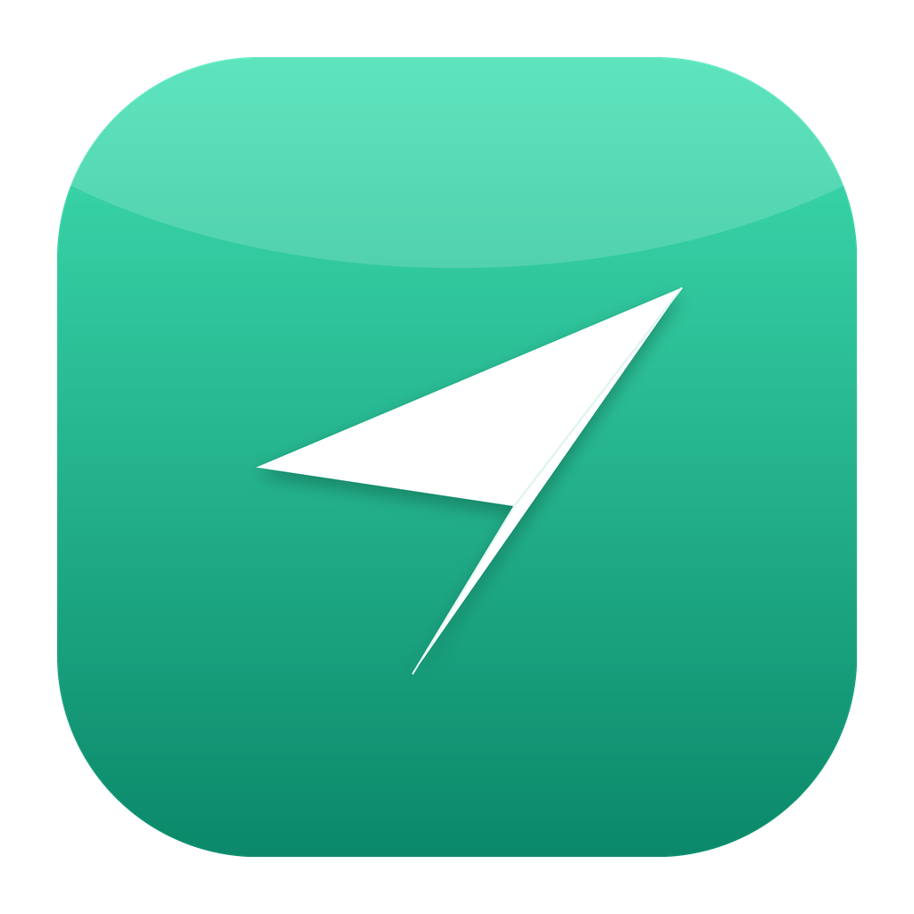
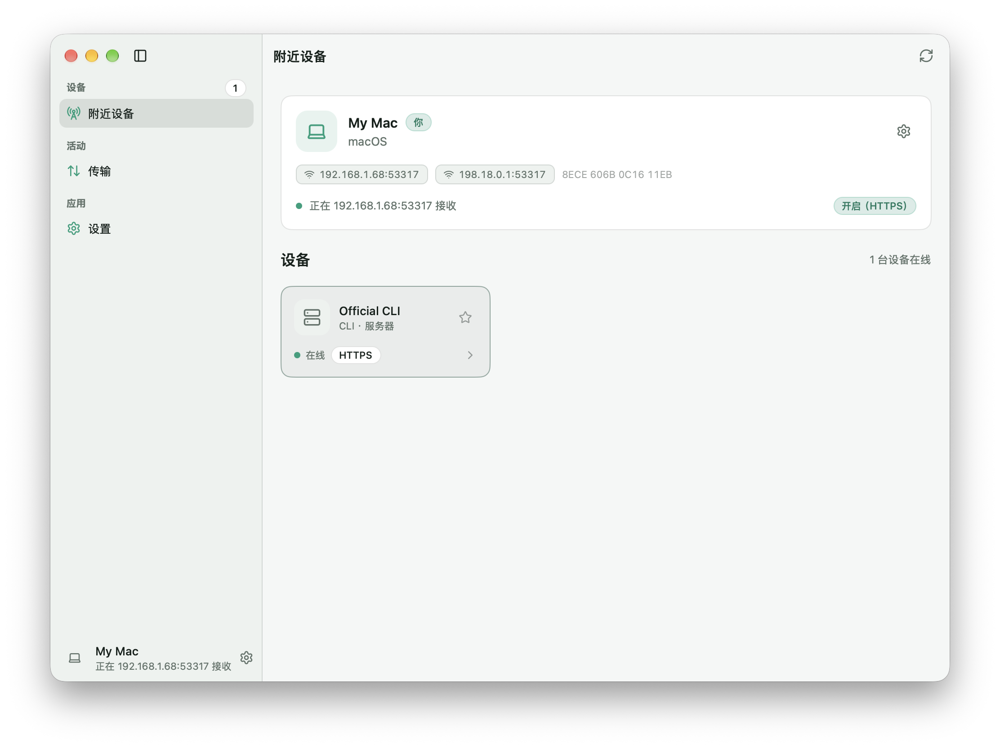

<p align="center">
  
</p>

<h1 align="center">LocalSend</h1>

<p align="center">
  <strong>English</strong> |
  <a href="README.zh-CN.md">简体中文</a>
</p>

<p align="center">
  <a href="https://github.com/oneo-me"></a>
  <a href="https://oneo.me"></a>
  <a href="https://x.com/oneo666"></a>
  <a href="https://github.com/sponsors/oneo-me"></a>
</p>

<p align="center">
  A native LocalSend client built with <a href="https://github.com/oneo-me/nsgo">NSGo</a>: find nearby devices and send files, folders and messages across macOS, Windows, Linux, iOS and Android, without a server or an account.
</p>

<p align="center">
  
</p>

## Features

- Speaks the LocalSend v2.2 protocol over mutual TLS, with plain HTTP for older setups.
- Finds devices by IPv4 multicast and falls back to scanning the local network.
- Sends files, folders and text messages, with per-file progress and cancellation.
- Receives after a review dialog, or accepts favorites automatically with Quick Save.
- Keeps favorites, transfer history, a receive PIN, checksum verification and a chosen receive folder.
- Shows a native sidebar layout on desktops and a tab bar on phones, in light and dark, in English and Simplified Chinese.

## Install

Download the package for your platform from [Releases](https://github.com/oneo-me/nsgo-localsend/releases/latest):

- macOS: `.dmg`
- Windows: `-setup.exe`
- Linux: `.deb` or Arch `.pkg.tar.gz`
- Android: `.apk`
- iOS: `.ipa`, unsigned unless a signing profile is configured

## Getting started

1. Open LocalSend on two devices connected to the same Wi-Fi.
2. Choose a device under **Nearby devices**.
3. Pick files or a folder, or write a message, then press **Send**.
4. Accept the transfer on the other device.

Received files go to `Downloads/LocalSend` on desktops, or the app's folder on phones. Change the folder, the device name, the port, encryption and the receive PIN in **Settings**. Devices with a star are favorites: they stay in the list while offline, and Quick Save accepts their transfers without asking.

## Development

LocalSend on NSGo needs Go 1.26 or later. Apple targets need Xcode, and Android needs the Android SDK's platform-tools.

```sh
go tool nsgo dev                    # run on this machine
go tool nsgo test                   # headless tests
go tool nsgo build                  # build every target into dist/
go tool nsgo test -target macos     # run the tests in native windows
go tool nsgo dev -target ios_simulator
```

Read [ARCHITECTURE.md](ARCHITECTURE.md) before changing the protocol or the app's state, and [AGENTS.md](AGENTS.md) for the working rules. User-visible changes go in [CHANGELOG.md](CHANGELOG.md).

## License

LocalSend on NSGo is licensed under the [MIT License](LICENSE). It implements the [LocalSend protocol](https://github.com/localsend/protocol) and is not affiliated with the LocalSend project.

Unless you explicitly state otherwise, any contribution intentionally submitted for inclusion in this project shall be licensed under the MIT license, without any additional terms or conditions.
