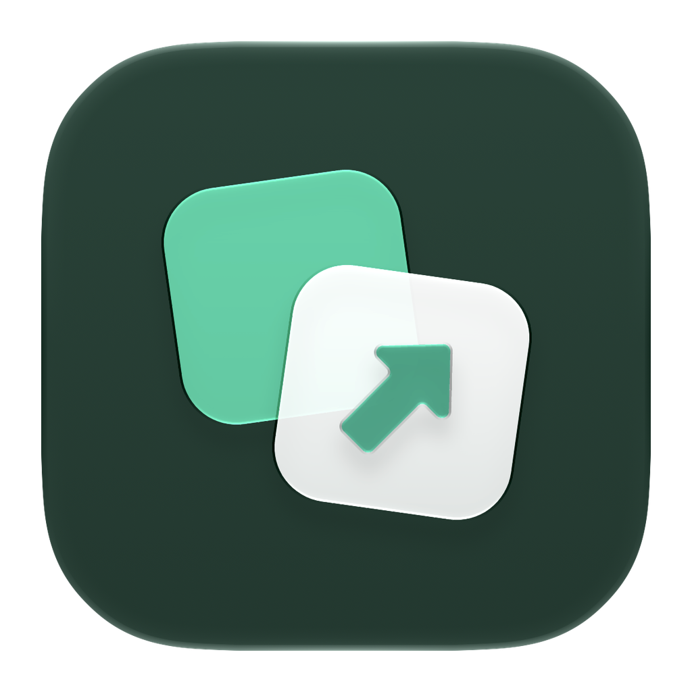
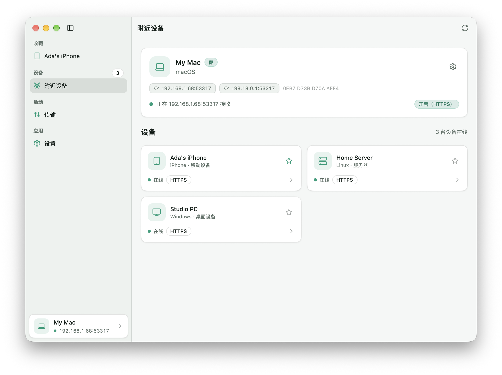
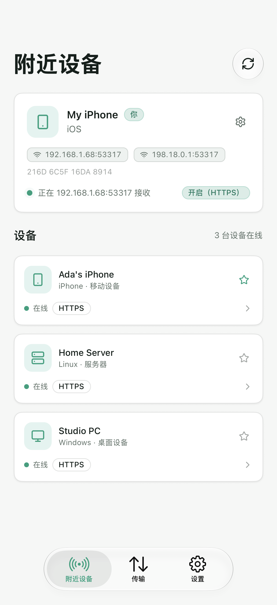
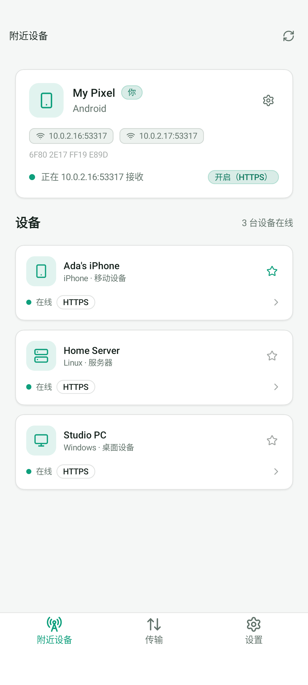

<p align="center">
  
</p>

<h1 align="center">Hando</h1>

<p align="center">
  <strong>简体中文</strong> |
  <a href="README.md">English</a>
</p>

<p align="center">
  <a href="https://github.com/oneo-me"></a>
  <a href="https://oneo.me"></a>
  <a href="https://x.com/oneo666"></a>
  <a href="https://github.com/sponsors/oneo-me"></a>
</p>

<p align="center">
  使用 <a href="https://github.com/oneo-me/nsgo">NSGo</a> 构建的原生文件互传应用：在 macOS、Windows、Linux、iOS 和 Android 之间发现附近设备并发送文件、文件夹和消息，不需要服务器或账号。它使用 LocalSend 协议，可与官方 LocalSend 应用互传。
</p>

<p align="center">
  
</p>

<p align="center">
  
  
</p>

## 功能

- 通过双向 TLS 使用 LocalSend v2.2 协议，也可用普通 HTTP 兼容旧设置。
- 通过 IPv4 组播发现设备，无法发现时回退到扫描局域网。
- 发送文件、文件夹和文字消息，支持逐文件进度和取消。
- 接收前显示确认对话框；开启快速保存后自动接收收藏设备的传输。
- 收藏、传输历史、接收 PIN、文件校验和自定义接收文件夹。
- 桌面使用原生侧边栏布局，手机使用标签栏，支持浅色、深色以及英文和简体中文。

## 安装

从 [Releases](https://github.com/oneo-me/nsgo-hando/releases/latest) 下载对应平台的安装包：

- macOS：`.dmg`
- Windows：`-setup.exe`
- Linux：`.deb` 或 Arch `.pkg.tar.gz`
- Android：`.apk`
- iOS：`.ipa`，未配置签名描述文件时为未签名包

## 开始使用

1. 在两台连接到同一个 Wi-Fi 的设备上打开 Hando 或 LocalSend。
2. 在 **附近设备** 中选择一台设备。
3. 选择文件或文件夹，或写一条消息，然后按 **发送**。在桌面端，也可以把文件拖到设备上。
4. 在另一台设备上接收传输。

桌面端的接收文件保存在 `Downloads/Hando`，手机端保存在应用文件夹。可在 **设置** 中修改保存文件夹、设备名称、端口、加密和接收 PIN。带星标的设备是收藏设备：离线时仍会显示，开启快速保存后无需确认即可接收它们的传输。

## 开发

Hando 需要 Go 1.26 或更高版本。Apple 平台需要 Xcode，Android 需要 Android SDK 的 platform-tools。

```sh
go tool nsgo dev                    # 在本机运行
go tool nsgo test                   # 无头测试
go tool nsgo build                  # 构建全部目标到 dist/
go tool nsgo test -target macos     # 在原生窗口中运行测试
go tool nsgo dev -target ios_simulator
```

修改协议或应用状态前请阅读 [ARCHITECTURE.md](ARCHITECTURE.md)，工作规则见 [AGENTS.md](AGENTS.md)。用户可见的变化记录在 [CHANGELOG.md](CHANGELOG.md)。

发布时修改 `nsgo.yaml` 的 `version`，把 `CHANGELOG.md` 的 `Unreleased` 移到该版本下，再推送标签 `v<version>`：CI 在 Mac 上构建所有安装包，发布为该标签的 GitHub Release，并以该版本的章节作为更新说明。

[website/](website/README.md) 是用 Astro 构建、发布到 GitHub Pages 的官方网站；在其中运行 `bun install && bun run dev`，可在 `/nsgo-hando/` 下预览。

## 许可证

Hando 使用 [MIT 许可证](LICENSE)。它实现了 [LocalSend 协议](https://github.com/localsend/protocol)，与 LocalSend 项目没有隶属关系。

除非你明确声明，否则任何有意提交以纳入本项目的贡献都应按 MIT 许可证授权，不附加任何额外条款或条件。
